<!--
  Este README não tem dados inventados. Os números marcados com "n:" e as tabelas
  marcadas com "gerado:" são escritos por testes/readme/graficos.mjs a partir de
  data/*.json, de js/lib/sm2.js e de uma execução real dos testes
  (docs/readme/dados/testes.json). As imagens de docs/readme/ são geradas por scripts
  do repositório (veja docs/tecnico.md). Para atualizar tudo, dentro de testes/,
  rode: npm run readme:visuais
-->

<h1 align="center">
  <picture>
    <source media="(prefers-color-scheme: dark)" srcset="./docs/readme/banner-escuro.svg">
    
  </picture>
</h1>

<p align="center"><strong>Plano de 6 semanas, flashcards, quiz e simulados para a prova de efetivação de Dev Júnior — tudo no seu navegador.</strong></p>

<p align="center">
  
  
  
  
</p>

<p align="center"><a href="https://th3usbit.github.io/rumo-ao-junior/"></a></p>

<p align="center"><sub>Sem instalar nada e sem cadastro. O seu progresso fica só no seu navegador.</sub></p>

<p align="center">
  <a href="#comece-em-1-minuto">Começar</a> ·
  <a href="#veja-funcionando">Veja funcionando</a> ·
  <a href="#o-conteúdo-em-números">Conteúdo</a> ·
  <a href="./docs/tecnico.md#como-funciona">Como funciona</a> ·
  <a href="./manual/index.html">Manual</a> ·
  <a href="./docs/tecnico.md#qualidade-testes-e-acessibilidade">Testes</a>
</p>

<p align="center">
  
</p>

O **Rumo ao Júnior** é um app web para você se preparar para a prova técnica de efetivação de **Dev Júnior** — front-end, back-end ou fullstack, na stack **Vue 3 + TypeScript** e **Spring Boot**. Dá para usar online ou rodar no seu computador. Ele junta num lugar só o plano de estudo, a revisão espaçada, o treino no formato da prova e o registro do seu tempo.

O app é HTML, CSS e JavaScript puro (ES modules): sem build, sem framework, sem login e sem back-end. O conteúdo são arquivos JSON que você pode editar, e o seu progresso fica salvo no navegador, com backup em `.json`.

<picture>
  <source media="(prefers-color-scheme: dark)" srcset="./docs/readme/numeros-escuro.svg">
  
</picture>

## Por que usar

- **Um plano pronto, dia a dia.** São <!-- n:dias -->42<!-- /n --> dias com <!-- n:tarefas -->124<!-- /n --> tarefas (<!-- n:horas-plano -->71h40<!-- /n --> no total). <!-- n:tarefas-com-acao -->79<!-- /n --> delas têm um botão que abre a página certa, já configurada: o quiz com o tema e a quantidade, o desafio do simulado, o tópico da trilha.
- **Revisão que se agenda sozinha.** <!-- n:flashcards -->241<!-- /n --> flashcards em <!-- n:temas -->11<!-- /n --> temas, com o algoritmo **SM-2** (SuperMemo, 1990). Você responde, dá uma nota e o app decide quando o cartão volta.
- **Treino no formato da prova.** <!-- n:questoes -->130<!-- /n --> questões de múltipla escolha, todas com explicação, e <!-- n:desafios -->17<!-- /n --> desafios inspirados em testes técnicos reais, com cronômetro e autoavaliação pelos critérios de cada um.
- **Seu tempo e seus pontos fracos à vista.** O Pomodoro registra as horas, o quiz calcula a taxa de acerto por tema e o Painel mostra onde focar.

## Comece em 1 minuto

O jeito mais rápido é usar a [versão online](https://th3usbit.github.io/rumo-ao-junior/). Para rodar na sua máquina, você precisa do **Node.js LTS** ([nodejs.org](https://nodejs.org/)) e de internet na primeira vez. O app em si não instala nada.

1. Dê **dois cliques em `start.bat`**, na pasta do projeto.
2. Espere 8 segundos (ou aperte `1`): o servidor local sobe em `http://localhost:3000` e o navegador abre sozinho.
3. No Painel, clique em **Começar plano**. O Dia 1 começa perguntando ao RH como é a prova e segue para o quiz diagnóstico.

<p align="center">
  
</p>

> [!IMPORTANT]
> Não abra o `index.html` com duplo clique. No endereço `file://`, o navegador bloqueia os módulos JavaScript e a leitura dos JSON, e o app só mostra um aviso. Use o `start.bat` (ou uma das opções abaixo) e **sempre o mesmo endereço**: o progresso fica salvo por endereço.

O **manual ilustrado** ensina cada tela, passo a passo: dê dois cliques em **`manual.bat`** (ele abre sem Node), use a opção **5** do `start.bat` ou o link **Manual de uso** no rodapé do menu do app.

<details>
<summary><strong>Outras formas de abrir</strong> (terminal, Live Server, <code>npx serve</code>, outra porta)</summary>

<br>

**Pelo terminal do VS Code (PowerShell)**, escreva `.\` antes do nome:

```powershell
.\start.bat            # menu (abre o app sozinho em 8 segundos)
.\start.bat app        # abre o app direto
.\start.bat testes     # roda os testes (instala as dependências na 1ª vez)
.\start.bat ui         # testes no modo visual do Playwright
.\start.bat relatorio  # relatório da última execução dos testes
.\start.bat manual     # abre o manual de uso (não precisa de Node)
```

O que o `start.bat` faz:

- confere o Node.js e, se faltar, explica como instalar;
- vê se o app já está aberto na porta: se estiver, só abre o navegador; se a porta estiver ocupada por outro programa, avisa;
- sobe o servidor com o `serve` já instalado pelos testes ou, se não houver, com `npx --yes serve`;
- abre o navegador assim que o servidor responde e mantém a janela aberta enquanto você estuda (`Ctrl+C` encerra).

**Outra porta:** rode `set PORTA=3001` (cmd) ou `$env:PORTA=3001` (PowerShell) antes do `start.bat`. Outra porta é outro endereço, e portanto outro progresso.

**Live Server (extensão do VS Code):** instale **Live Server** (Ritwick Dey), clique com o botão direito em `index.html` → **Open with Live Server**. Abre em `http://127.0.0.1:5500/index.html` e recarrega sozinho quando você salva um JSON.

**`npx serve`:** no terminal, dentro da pasta do projeto, rode `npx serve` e abra `http://localhost:3000`. `Ctrl+C` para parar.

</details>

## O que tem dentro

| Página | O que você faz lá | Em números |
|---|---|---|
| **Painel** | Vê o dia do plano, a próxima tarefa, a sequência de dias, as revisões e as horas da semana, os pontos fracos do quiz e o lembrete de backup | <!-- n:itens-progresso -->349<!-- /n --> itens contam para o progresso geral |
| **Trilhas** | Estuda por tópico: prioridade, descrição, links "Onde estudar", checklist marcável e suas anotações | <!-- n:trilhas -->4<!-- /n --> trilhas, <!-- n:topicos -->32<!-- /n --> tópicos, <!-- n:itens -->225<!-- /n --> itens |
| **Cronograma** | Segue o plano semana a semana, marca tarefas e abre a página de cada uma | <!-- n:semanas -->6<!-- /n --> semanas, <!-- n:dias -->42<!-- /n --> dias, <!-- n:tarefas -->124<!-- /n --> tarefas |
| **Flashcards** | Revisa a fila do dia com SM-2, cria cartões próprios e faz treino livre | <!-- n:flashcards -->241<!-- /n --> cartões, <!-- n:novos-por-dia -->15<!-- /n --> novos por dia (ajustável) |
| **Quiz** | Treina com correção na hora ou faz prova cronometrada; erros viram flashcards | <!-- n:questoes -->130<!-- /n --> questões com explicação |
| **Simulado** | Faz um desafio no formato de teste técnico, com cronômetro, rascunho e autoavaliação | <!-- n:desafios -->17<!-- /n --> desafios, <!-- n:gabaritos -->6<!-- /n --> com gabarito |
| **Pomodoro** | Foca 25 minutos, pausa 5 e registra as horas (ou registra à mão) | as horas vão para o Painel e o Diário |
| **Diário** | Escreve o que estudou, o que ficou difícil e o próximo passo | o "difícil" vira flashcard (a pergunta já vem preenchida) |
| **Recursos** | Acha links gratuitos por categoria e idioma | <!-- n:links -->138<!-- /n --> links em <!-- n:categorias -->14<!-- /n --> categorias, verificados em <!-- n:links-verificados-em -->23/09/2026<!-- /n --> |
| **Ajustes e backup** | Escolhe o tema, as datas e as metas, exporta e importa o backup e confere o conteúdo carregado | backup em `.json` |

O passo a passo de cada tela, com prints e legendas numeradas, está no [manual](./manual/index.html).

## Veja funcionando

Todas as demonstrações abaixo foram **gravadas no app de verdade**, com o progresso zerado e interações reais (cliques, teclas, uma resposta errada de propósito). O relógio só é adiantado no Pomodoro e no Simulado, e a legenda avisa quando isso acontece. Elas param sozinhas depois de algumas voltas.

### Flashcards com repetição espaçada

A pergunta aparece sozinha; `Espaço` revela a resposta e as teclas `1` a `4` dão a nota. O cartão que você erra volta no fim da fila, no mesmo dia.

<p align="center"></p>

### Quiz com correção e explicação

No modo treino, a correção mostra a alternativa certa, a sua e a explicação. Todo erro pode virar um flashcard.

<p align="center"></p>

### Simulado cronometrado

Cronômetro regressivo (que continua se você trocar de página), rascunho salvo sozinho e autoavaliação pelos critérios do desafio.

<p align="center"></p>

### Pomodoro que conta as horas

Os minutos de foco viram horas estudadas no Painel. O tempo aparece também no título da aba e no menu.

<p align="center"></p>

<details>
<summary><strong>Mais demonstrações:</strong> Trilhas, Cronograma, Diário, Recursos e Ajustes · tema escuro · celular</summary>

<br>

<p align="center"></p>

<p align="center"></p>

<p align="center"></p>

</details>

## O conteúdo em números

Tudo o que o app ensina está em `data/*.json`. Os gráficos abaixo são desenhados a partir desses arquivos, e cada um diz de qual arquivo veio.

<picture>
  <source media="(prefers-color-scheme: dark)" srcset="./docs/readme/grafico-cronograma-escuro.svg">
  
</picture>

A rotina-base é de cerca de **1h45 por dia**: 30 min de algoritmo, 60 min de estudo ou projeto e 15 min de flashcards. <!-- n:dias-1h45 -->24<!-- /n --> dos <!-- n:dias -->42<!-- /n --> dias têm exatamente esse tempo; os dias de simulado são mais longos, e o domingo é de descanso ativo, só com a fila de flashcards.

<details>
<summary>Tabela: tempo por semana e por tipo de tarefa</summary>

<br>

<!-- gerado:cronograma -->
| Semana | Foco | Tarefas | Algoritmo | Estudo | Projeto | Revisão | Simulado | Descanso ativo | Total |
|---|---|---:|---:|---:|---:|---:|---:|---:|---:|
| 1 | Fundamentos: lógica, estruturas, Git e HTTP | 23 | 3h | 5h35 | — | 2h05 | 30 min | 15 min | **11h25** |
| 2 | POO, SQL, testes e clean code | 20 | 3h | 5h40 | — | 1h30 | 40 min | 15 min | **11h05** |
| 3 | Projeto front: Vue 3 + TypeScript consumindo API pública | 20 | 3h | — | 6h | 1h45 | — | 15 min | **11h** |
| 4 | Projeto back: API REST com Spring Boot | 20 | 3h | — | 6h | 1h45 | — | 15 min | **11h** |
| 5 | Simulados I: os formatos da prova | 19 | 3h | — | — | 2h30 | 7h30 | 15 min | **13h15** |
| 6 | Simulados II e reta final | 22 | 2h45 | 2h15 | — | 2h05 | 6h25 | 25 min | **13h55** |
<!-- /gerado:cronograma -->

</details>

<picture>
  <source media="(prefers-color-scheme: dark)" srcset="./docs/readme/grafico-temas-escuro.svg">
  
</picture>

<details>
<summary>Tabela: flashcards e questões por tema</summary>

<br>

<!-- gerado:temas -->
| Tema | Flashcards | Questões |
|---|---:|---:|
| JavaScript e TypeScript | 23 | 14 |
| Vue 3 | 20 | 11 |
| HTML e CSS | 17 | 10 |
| Java | 23 | 11 |
| Spring Boot | 29 | 14 |
| SQL e Bancos de Dados | 21 | 12 |
| Git | 18 | 12 |
| HTTP e REST | 22 | 10 |
| POO, SOLID e Clean Code | 21 | 11 |
| Testes | 27 | 14 |
| Algoritmos e Estruturas de Dados | 20 | 11 |
| **Total** | **241** | **130** |
<!-- /gerado:temas -->

</details>

<picture>
  <source media="(prefers-color-scheme: dark)" srcset="./docs/readme/grafico-trilhas-escuro.svg">
  
</picture>

<details>
<summary>Tabela: trilhas, tópicos, itens e links</summary>

<br>

<!-- gerado:trilhas -->
| Trilha | Tópicos | Alta · média · baixa | Itens de checklist | Links |
|---|---:|:---:|---:|---:|
| Núcleo Comum | 8 | 7 · 1 · 0 | 65 | 31 |
| Front-end | 10 | 8 · 1 · 1 | 72 | 36 |
| Back-end | 8 | 5 · 3 · 0 | 56 | 31 |
| Fullstack | 6 | 3 · 3 · 0 | 32 | 20 |
| **Total** | **32** | | **225** | **118** |
<!-- /gerado:trilhas -->

</details>

<picture>
  <source media="(prefers-color-scheme: dark)" srcset="./docs/readme/grafico-desafios-escuro.svg">
  
</picture>

<details>
<summary>Tabela: os desafios de simulado</summary>

<br>

<!-- gerado:desafios -->
| Desafio | Área | Formato | Nível | Tempo | Gabarito |
|---|---|---|---|---:|:---:|
| Buscador de CEP com histórico | Front-end | Desafio para casa | básico | 1h30 | — |
| Catálogo de Pokémon com busca, filtro e paginação | Front-end | Desafio para casa | intermediário | 3h | — |
| Quadro Kanban com persistência | Front-end | Desafio para casa | intermediário | 3h | — |
| Cadastro em etapas com validação acessível | Front-end | Desafio para casa | básico | 2h | — |
| Explorador de usuários do GitHub | Front-end | Desafio para casa | intermediário | 2h30 | — |
| API de transações e estatísticas em memória | Back-end | Desafio para casa | básico | 2h30 | ✓ |
| API de transferências simplificada | Back-end | Desafio para casa | intermediário | 4h | — |
| Encurtador de URLs | Back-end | Desafio para casa | básico | 2h | — |
| API de pedidos com baixa de estoque | Back-end | Desafio para casa | intermediário | 3h | — |
| Relatório de vendas a partir de CSV em Java puro | Back-end | Prova prática | básico | 1h30 | ✓ |
| Clientes e contatos 1:N | Fullstack | Desafio para casa | intermediário | 4h | — |
| Controle financeiro pessoal | Fullstack | Desafio para casa | intermediário | 4h | — |
| Enquetes com votação e resultados | Fullstack | Desafio para casa | avançado | 4h | — |
| Consultas SQL de um e-commerce | Núcleo comum | Prova prática | básico | 1h | ✓ |
| Live coding: validador de senha com TDD | Núcleo comum | Live coding | básico | 45 min | ✓ |
| Live coding: agrupar e ranquear pedidos | Núcleo comum | Live coding | básico | 40 min | ✓ |
| Code review: encontre os problemas | Núcleo comum | Code review | intermediário | 40 min | ✓ |
<!-- /gerado:desafios -->

</details>

<picture>
  <source media="(prefers-color-scheme: dark)" srcset="./docs/readme/grafico-recursos-escuro.svg">
  
</picture>

<details>
<summary>Tabela: recursos por categoria e idioma</summary>

<br>

<!-- gerado:recursos -->
| Categoria | Links | Inglês | Português | Português (PT) |
|---|---:|---:|---:|---:|
| Front-end (HTML, CSS, JS, TS) | 17 | 5 | 12 | — |
| Roadmaps e trilhas | 14 | 12 | 2 | — |
| Spring | 13 | 13 | — | — |
| HTTP, REST e APIs públicas | 13 | 4 | 9 | — |
| Vue e ecossistema | 11 | 10 | — | 1 |
| Testes | 11 | 11 | — | — |
| Prática de algoritmos | 10 | 9 | 1 | — |
| Desafios técnicos reais | 10 | 3 | 7 | — |
| Carreira e comunidade BR | 9 | — | 9 | — |
| SQL e bancos de dados | 7 | 6 | 1 | — |
| Git | 7 | 2 | 5 | — |
| Java | 6 | 5 | 1 | — |
| Clean code e arquitetura | 5 | 3 | 2 | — |
| Docker e DevOps básico | 5 | 5 | — | — |
<!-- /gerado:recursos -->

</details>

## Guia de uso rápido

<details>
<summary><strong>Atalhos de teclado</strong></summary>

<br>

| Onde | Tecla | O que faz |
|---|---|---|
| Flashcards | `Espaço` ou `Enter` | Mostra a resposta |
| Flashcards | `1` `2` `3` `4` | Errei, Difícil, Bom, Fácil |
| Quiz | `1` a `4` | Escolhe a alternativa |
| Quiz (treino) | `Enter` | Responde |
| Diário | `Ctrl+Enter` | Salva |
| Diálogos | `Esc` | Fecha sem salvar |
| Menu no celular | `Esc` | Fecha o menu |
| Qualquer página | `Tab` no início | Mostra "Pular para o conteúdo" |

</details>

<details>
<summary><strong>Regras do app</strong> (sequência, pontos fracos, cartões novos, onde ficam os dados)</summary>

<br>

- **Sequência de dias:** conta os dias seguidos com alguma ação de estudo — marcar um item ou uma tarefa, avaliar um flashcard, responder uma questão, criar o diário do dia, registrar tempo (Pomodoro, manual ou simulado) ou salvar a avaliação de um simulado. Se você ainda não estudou hoje, a sequência de ontem vale até o fim do dia.
- **Progresso geral:** itens de checklist mais tarefas do cronograma que você marcou, sobre o total (<!-- n:itens-progresso -->349<!-- /n -->).
- **Cartões novos:** <!-- n:novos-por-dia -->15<!-- /n --> por dia por padrão (de 0 a 100, em Ajustes), intercalando os temas. No fim da fila dá para estudar mais 10.
- **Pontos fracos:** as últimas 20 respostas de cada tema, a partir de 5. Abaixo de 60% é ponto fraco; de 60% a 79%, atenção.
- **Horas da semana:** Pomodoro, registros manuais e simulados, de segunda a domingo.
- **Onde ficam os dados:** no `localStorage` do navegador, separado por endereço. `localhost:3000` e `127.0.0.1:5500` guardam progressos diferentes. Para trocar de computador ou de endereço, exporte e importe o backup.

</details>

<details>
<summary><strong>Backup do progresso</strong></summary>

<br>

O progresso (checklists, cronograma, flashcards, quiz, simulados, sessões e diário) fica no **localStorage** deste navegador, **neste endereço**. Ele se perde se você limpar os dados do site ou usar uma janela anônima.

- **Exportar:** clique em **Exportar**, no rodapé do menu (ou em Ajustes). O navegador baixa `rumo-ao-junior-backup-AAAA-MM-DD.json`. Guarde numa nuvem. O Painel avisa quando você nunca exportou ou o último backup tem 7 dias ou mais.
- **Importar:** clique em **Importar** e escolha o arquivo. O app confere se é um backup válido e pede confirmação, porque a importação **substitui** o progresso atual. Um arquivo inválido é recusado sem mexer em nada.
- **Recomeçar do zero:** Ajustes → Zona de perigo → **Apagar todo o progresso**. Exporte antes.

</details>

<details>
<summary><strong>Solução de problemas</strong></summary>

<br>

| Sintoma | Causa provável e solução |
|---|---|
| Aparece "Abra pelo servidor local" ou a página fica em "Carregando…" | A página foi aberta com duplo clique (`file://`). Use o `start.bat`. |
| Editei um JSON e nada mudou | Recarregue com `Ctrl+F5` e veja se apareceu uma faixa vermelha de JSON inválido no topo. |
| Meu progresso sumiu | Você abriu por outro endereço ou porta, ou limpou os dados do navegador. Volte ao endereço de sempre ou importe o último backup. |
| O alarme do Pomodoro não tocou | O navegador só libera som depois de um clique na página. Clique em "Iniciar" pelo menos uma vez; com a aba em segundo plano, ative a notificação em Pomodoro → Configurações do timer. O tempo registrado continua exato. |
| O `start.bat` diz que o Node não foi encontrado | Instale o Node.js LTS e reabra o VS Code. Sem o Node, o `manual.bat` ainda abre o manual. |
| O `start.bat` diz que a porta 3000 está ocupada | Feche o outro programa ou use outra porta (`$env:PORTA=3001`). Outro endereço guarda outro progresso. |
| `start.bat` não é reconhecido no terminal | No PowerShell, escreva `.\start.bat`. |

</details>

<details>
<summary><strong>Limitações conhecidas</strong></summary>

<br>

- Um quiz em andamento fica só na memória: recarregar a página (`F5`) perde a rodada. Pomodoro e simulado sobrevivem ao `F5`.
- Começar um simulado pausa o Pomodoro, mas nada o retoma no fim: use **Retomar**.
- "Focar com Pomodoro" (Painel) e "Focar" (Cronograma) reiniciam o foco em curso sem registrar os minutos parciais; **Pular** e **Zerar** registram.
- O SM-2 usa o intervalo anterior, não os dias reais desde a última revisão: revisar com atraso não muda a conta.
- O progresso não sincroniza entre computadores: use o backup.

</details>

## Pesquisa e fontes

O arquivo [`docs/pesquisa.md`](./docs/pesquisa.md) reúne o que costuma cair em provas técnicas de Dev Júnior no Brasil (formatos, critérios publicados por empresas e temas recorrentes), o que pesa na efetivação de estagiários, as técnicas de estudo com evidência científica (prática de recuperação, prática espaçada, intercalação, simulados) e a lista de fontes. No VS Code, abra o arquivo e use `Ctrl+Shift+V` para ver formatado.

## Documentação técnica

Para quem quer entender ou alterar o projeto, a [documentação técnica](./docs/tecnico.md) reúne:

- [Como funciona](./docs/tecnico.md#como-funciona)
- [Qualidade: testes e acessibilidade](./docs/tecnico.md#qualidade-testes-e-acessibilidade)
- [Editar ou adicionar conteúdo](./docs/tecnico.md#editar-ou-adicionar-conteúdo)
- [Estrutura das pastas](./docs/tecnico.md#estrutura-das-pastas)
- [Como os visuais deste README são gerados](./docs/tecnico.md#como-os-visuais-deste-readme-são-gerados)
