# Documentação técnica do Rumo ao Júnior

Como o app foi construído, como ele é testado e como alterar o conteúdo. Para usar o app, veja o [README](../README.md).

## Como funciona

### Arquitetura

Uma página só (`index.html`) carrega `js/app.js`, que lê o conteúdo de `data/*.json`, guarda o progresso no `localStorage` e monta a página da rota atual (`#/pagina?parametros`). Não há servidor de aplicação: o `serve` do `start.bat` só entrega arquivos.

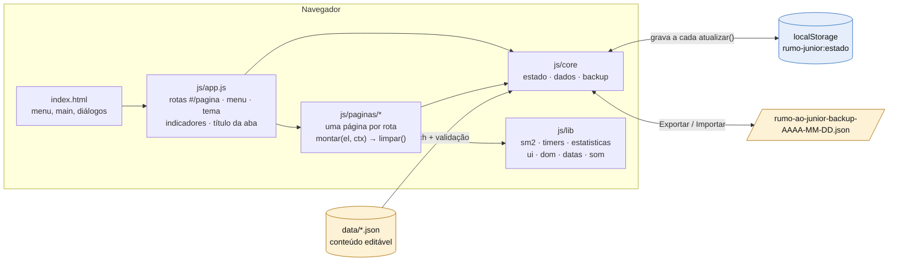

### Do duplo clique ao app aberto

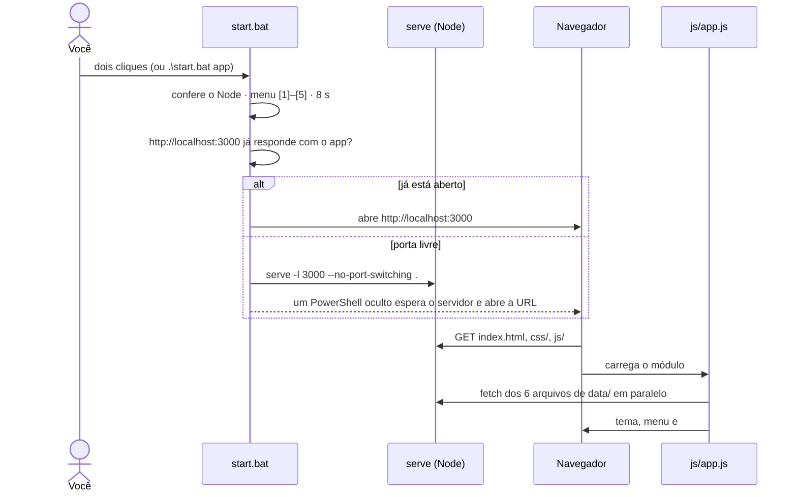

### Como as páginas conversam

As páginas não guardam nada sozinhas: todas leem e gravam o mesmo estado. É assim que uma ação numa página aparece em outra.

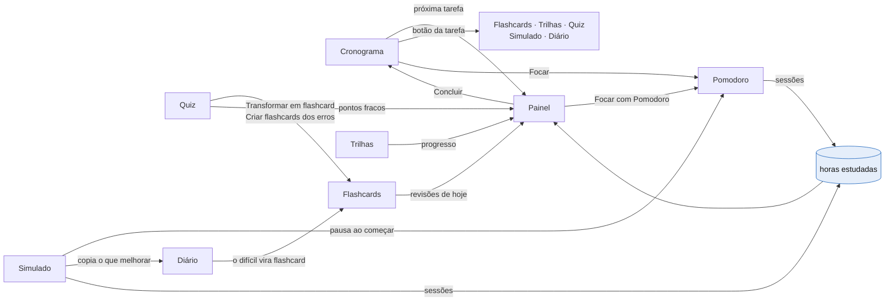

<details>
<summary><strong>O estado:</strong> como uma alteração é salva e chega às páginas</summary>

<br>

Tudo fica num único objeto em `localStorage['rumo-junior:estado']` (esquema completo no topo de `js/core/estado.js`). Cada alteração passa por `atualizar(alteração, motivo)`, que salva e avisa quem está ouvindo. Os motivos que vêm da digitação (`nota`, `pomodoro-rotulo`, `simulado-notas`) não re-renderizam a página, para o cursor não pular.

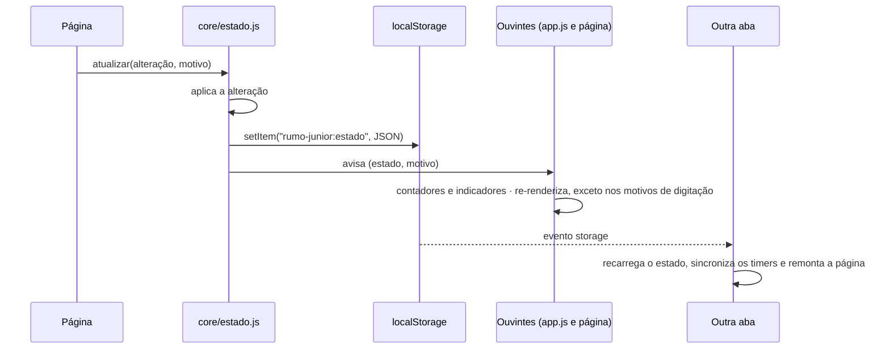

</details>

### Repetição espaçada (SM-2)

Os botões dão notas do SM-2: **Errei = 1**, **Difícil = 3**, **Bom = 4** e **Fácil = 5**. O código está em `js/lib/sm2.js`, com a referência ao texto original.

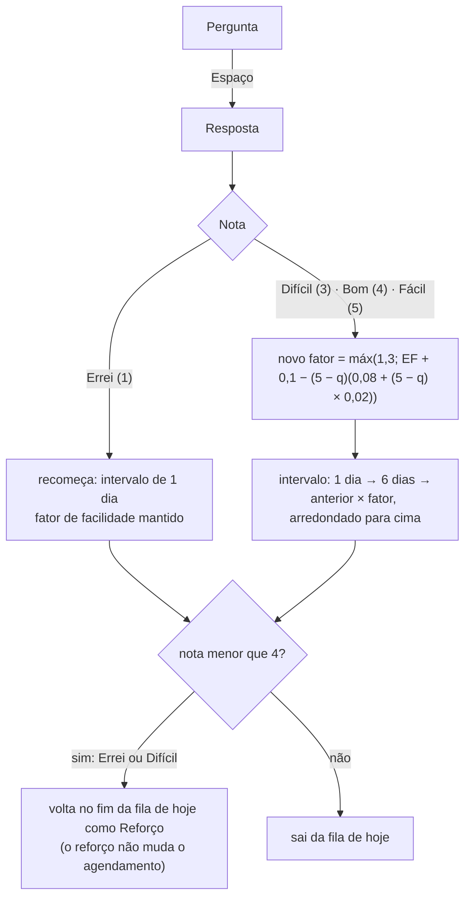

O gráfico abaixo roda essa mesma função (`revisar()` de `js/lib/sm2.js`) para um cartão respondido sempre com a mesma nota. Com **Bom**, os intervalos são de <!-- n:sm2-bom -->1, 6, 15, 38, 95<!-- /n --> dias.

<picture>
  <source media="(prefers-color-scheme: dark)" srcset="./readme/grafico-sm2-escuro.svg">
  
</picture>

<details>
<summary>Tabela: dias de revisão nos primeiros 180 dias</summary>

<br>

<!-- gerado:sm2 -->
| Respondendo sempre… | Revisões nos dias (até o dia 180) |
|---|---|
| Sempre Fácil | 1, 7, 24, 74 |
| Sempre Bom | 1, 7, 22, 60, 155 |
| Sempre Difícil | 1, 7, 20, 46, 93, 172 |
| Bom, com um Errei | 1, 7, 22, 23, 24, 30, 45, 83, 178 |
<!-- /gerado:sm2 -->

</details>

### Cronômetros que continuam entre páginas

O Pomodoro e o Simulado guardam no estado o horário em que terminam (`fimEm`), e não um contador. Por isso sobrevivem à troca de página, à aba em segundo plano e ao `F5`: ao reabrir, o que venceu com o app fechado é encerrado e registrado.

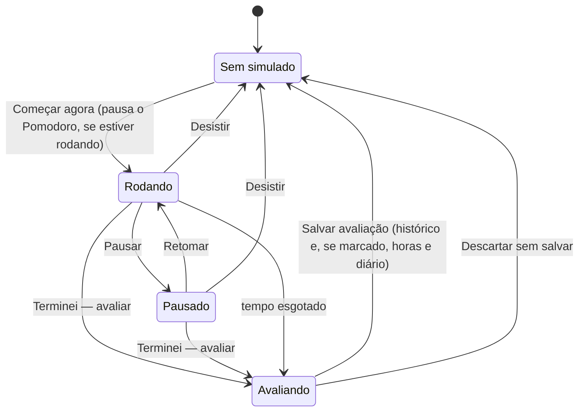

<details>
<summary><strong>A máquina de estados do Pomodoro</strong></summary>

<br>

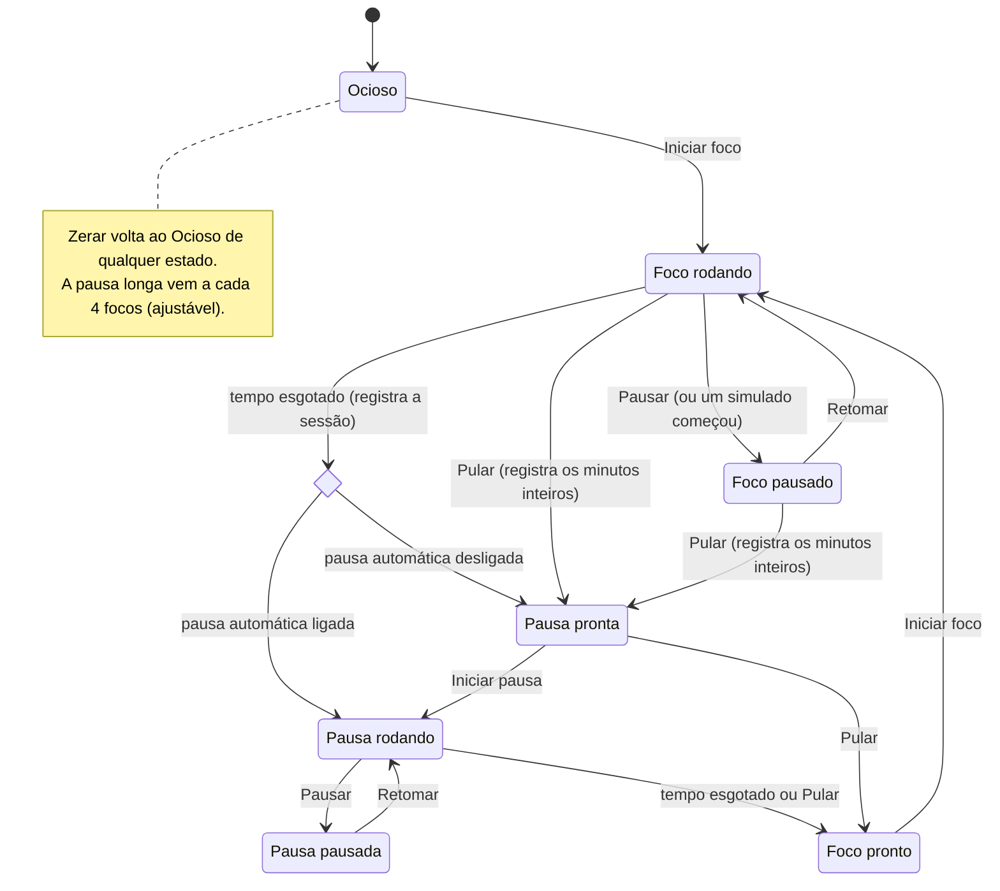

</details>

### Validação do conteúdo

Você pode editar os JSON à mão: o app confere cada arquivo quando carrega e nunca para por causa de um erro.

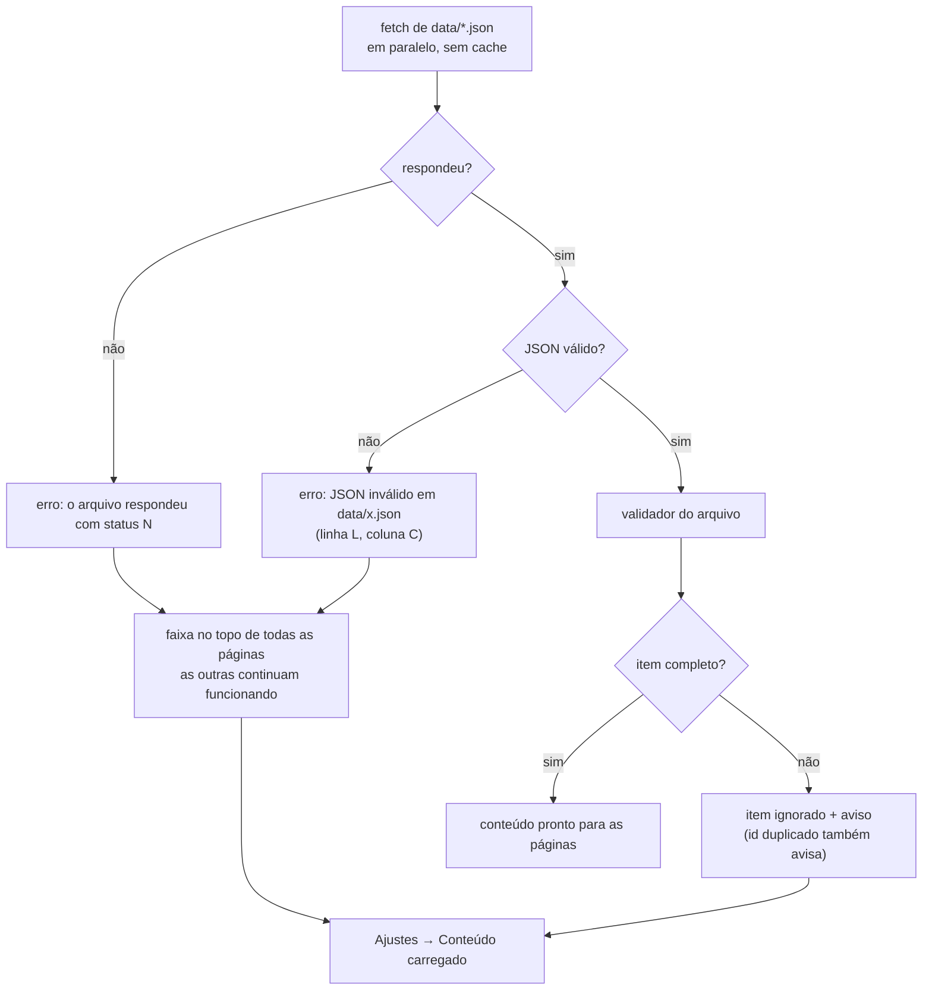

<details>
<summary><strong>Importar um backup</strong>, passo a passo</summary>

<br>

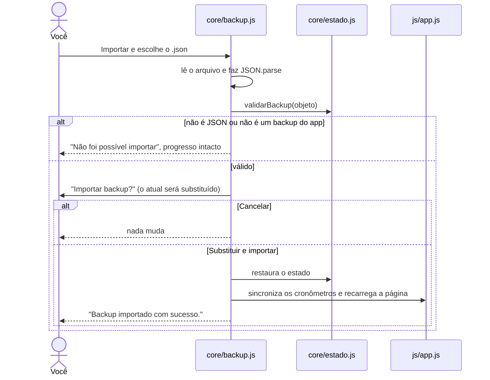

</details>

<details>
<summary><strong>Todos os caminhos do <code>start.bat</code></strong></summary>

<br>

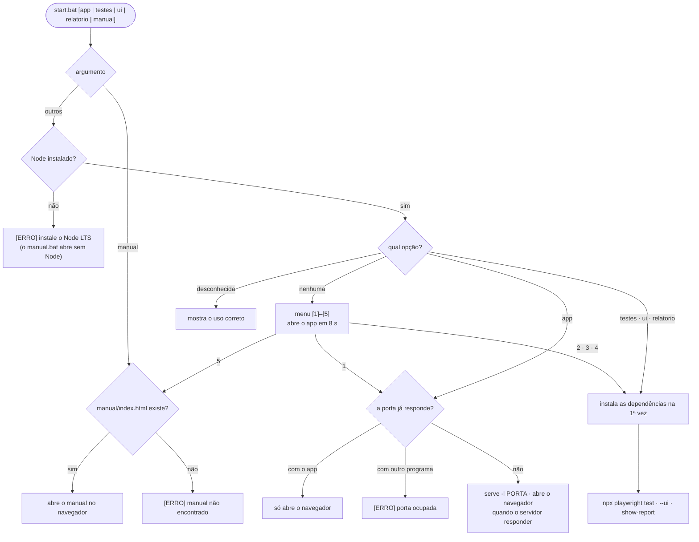

</details>

## Qualidade: testes e acessibilidade

A pasta `testes/` tem uma suíte de ponta a ponta com **Playwright**, que roda no Google Chrome já instalado. Na última execução, em <!-- n:testes-data -->11/11/2026<!-- /n -->, foram <!-- n:testes-total -->160<!-- /n --> testes em <!-- n:testes-projetos -->3<!-- /n --> projetos (desktop, celular e tema escuro): <!-- n:testes-aprovados -->157<!-- /n --> aprovados, <!-- n:testes-pulados -->3<!-- /n --> pulados de propósito (valem só para um tipo de tela) e <!-- n:testes-falharam -->0<!-- /n --> com falha, em <!-- n:testes-duracao -->6 min<!-- /n -->.

<picture>
  <source media="(prefers-color-scheme: dark)" srcset="./readme/grafico-testes-escuro.svg">
  
</picture>

<details>
<summary>Tabela: testes por arquivo</summary>

<br>

<!-- gerado:testes -->
| Arquivo | Área | Testes | Aprovados | Pulados | Falharam |
|---|---|---:|---:|---:|---:|
| `e2e/acessibilidade.spec.ts` | Acessibilidade (axe-core) | 48 | 46 | 2 | 0 |
| `e2e/manual.spec.ts` | Manual de uso | 24 | 24 | 0 | 0 |
| `e2e/rotina.spec.ts` | Simulado, Pomodoro, Diário e mais | 20 | 20 | 0 | 0 |
| `e2e/responsivo.spec.ts` | Responsividade | 16 | 16 | 0 | 0 |
| `e2e/navegacao.spec.ts` | Navegação | 14 | 13 | 1 | 0 |
| `e2e/plano.spec.ts` | Painel, Trilhas e Cronograma | 12 | 12 | 0 | 0 |
| `e2e/pratica.spec.ts` | Flashcards e Quiz | 12 | 12 | 0 | 0 |
| `e2e/visual.spec.ts` | Capturas de cada tela | 6 | 6 | 0 | 0 |
| `e2e/dados.spec.ts` | JSON editado à mão | 5 | 5 | 0 | 0 |
| `e2e/readme.spec.ts` | README em dia com os dados | 3 | 3 | 0 | 0 |
| **Total** | desktop, celular, escuro | **160** | **157** | **3** | **0** |
<!-- /gerado:testes -->

</details>

O que a suíte garante:

- **Nenhum erro no console:** qualquer erro ou aviso do navegador reprova o teste.
- **Tempo simulado:** o relógio do Playwright (`page.clock`) testa um Pomodoro de 25 minutos ou um simulado de 90 em segundos.
- **Acessibilidade automática:** o **axe-core** confere as regras WCAG 2.1 e 2.2 nível AA em todas as páginas e em estados interativos (flashcard revelado, questão respondida, simulado rodando, diálogo aberto).
- **Teclado e foco:** o contorno de foco aparece em toda a navegação por `Tab`, e o diálogo fecha com `Esc` devolvendo o foco a quem o abriu.
- **Responsividade:** sem rolagem horizontal de 320 a 1440 px e alvos de toque com pelo menos 24 × 24 px.
- **Dados editados à mão:** JSON quebrado mostra arquivo, linha e coluna; itens inválidos e ids duplicados geram aviso; HTML no conteúdo aparece como texto (sem injeção de script).

Acessibilidade no app, além dos testes: HTML semântico com um `h1` por página, link "Pular para o conteúdo", foco no título ao trocar de página, diálogos nativos (`<dialog>`), status sempre com **ícone e texto** (nunca só cor), tabela equivalente em cada gráfico ("Ver como tabela") e respeito a `prefers-reduced-motion` e `prefers-color-scheme`.

```bash
cd testes
npm install              # só na primeira vez
npm test                 # roda tudo (o servidor sobe sozinho)
npm run test:ui          # modo interativo: veja cada passo
npm run relatorio        # relatório HTML da última execução
```

## Editar ou adicionar conteúdo

Depois de salvar um arquivo em `data/`, recarregue a página com `F5` (ou `Ctrl+F5`). O Live Server recarrega sozinho. Se algo estiver errado, o app mostra o arquivo e a linha, e as outras páginas continuam funcionando.

<details>
<summary><strong>Regras de ouro do JSON</strong> e mini-markdown dos textos</summary>

<br>

- **Formato:** aspas **duplas** em chaves e textos; vírgula entre os itens e **nenhuma** depois do último; sem comentários; aspas dentro de um texto como `\"` e quebra de linha como `\n`.
- **Ids:** todo item tem um `id` **único**. **Não mude o `id` de um item que você já estudou**: o progresso está ligado ao id. Para corrigir um texto, altere só o texto.
- **Erros:** JSON com erro de sintaxe mostra uma faixa vermelha com **arquivo, linha e coluna**. Itens incompletos (por exemplo, uma questão sem `correta`) são ignorados e listados em **Ajustes → Conteúdo carregado**.
- **Dica:** o VS Code marca erros de JSON enquanto você digita; `Shift+Alt+F` formata o arquivo.

Os campos de texto (perguntas, respostas, enunciados, descrições) aceitam:

| Escreva | Para obter |
|---|---|
| `` `codigo` `` | código na linha |
| `**negrito**` | **negrito** |
| linhas começando com `- ` | lista |
| `\n` | quebra de linha (`\n\n` separa parágrafos) |
| ` ```java\n...\n``` ` | bloco de código, com a linguagem opcional |

Tags HTML não funcionam: por segurança, aparecem como texto.

</details>

<details>
<summary><strong>Flashcards</strong> (<code>data/flashcards.json</code>) e <strong>quiz</strong> (<code>data/quiz.json</code>)</summary>

<br>

Temas disponíveis (use o `id`): `js-ts`, `vue`, `html-css`, `java`, `spring`, `sql`, `git`, `http`, `oop`, `testes`, `algoritmos`. Para criar um tema, adicione `{ "id": "angular", "nome": "Angular" }` em `"temas"`.

```json
{
  "id": "spring-030",
  "tema": "spring",
  "pergunta": "Para que serve o `@Transactional`?",
  "resposta": "Abre uma transação no início do método e faz **commit** no fim — ou **rollback** se sair uma exceção não verificada.\nUse na camada de service."
}
```

Cartões criados pelo app (Flashcards → **Novo cartão**) ficam no seu progresso, entram no backup e não alteram o JSON.

```json
{
  "id": "q-sql-013",
  "tema": "sql",
  "enunciado": "Qual cláusula filtra **grupos** depois do `GROUP BY`?",
  "alternativas": ["`WHERE`", "`HAVING`", "`ORDER BY`", "`LIMIT`"],
  "correta": 1,
  "explicacao": "`HAVING` filtra depois da agregação; `WHERE` filtra linhas antes dela."
}
```

`correta` é o **índice** da alternativa certa, **começando em 0**. O app embaralha as alternativas, então não use "todas as anteriores", "A e B" nem letras.

</details>

<details>
<summary><strong>Desafios</strong> (<code>data/desafios.json</code>), <strong>trilhas</strong>, <strong>cronograma</strong> e <strong>recursos</strong></summary>

<br>

```json
{
  "id": "back-todo",
  "titulo": "API de tarefas com filtros",
  "area": "back",
  "formato": "take-home",
  "nivel": "básico",
  "tempoSugeridoMin": 120,
  "stack": ["Java 21", "Spring Boot 3"],
  "resumo": "Uma frase para o card da lista.",
  "contexto": "Texto da empresa (fictícia).",
  "enunciado": "O que construir (aceita mini-markdown).",
  "requisitos": ["Requisito obrigatório 1", "Requisito 2"],
  "diferenciais": ["Bônus 1"],
  "criterios": ["Critério verificável 1 (vira checklist na autoavaliação)"],
  "entrega": "Repositório público com README.",
  "dicas": ["Dica 1"],
  "gabarito": "(opcional) solução de referência, mostrada só quando você pede",
  "inspiracao": [{ "titulo": "Desafio real", "url": "https://..." }]
}
```

- **`area`:** `front`, `back`, `fullstack` ou `comum`. **`formato`:** `take-home`, `live-coding`, `prova-pratica` ou `code-review`. **`nivel`:** texto livre (ex.: `básico`, `intermediário`, `avançado`).
- **Trilhas** (`data/trilhas.json`): cada tópico tem `id`, `titulo`, `descricao`, `prioridade` (`alta`, `media` ou `baixa`), `links` (`{ "titulo", "url", "idioma" }`) e `checklist` (`{ "id", "texto" }`). Os ids do checklist precisam ser únicos em **todas** as trilhas.
- **Cronograma** (`data/cronograma.json`): `semanas` → `dias` → `tarefas`. Cada tarefa tem `id`, `tipo` (`algoritmo`, `estudo`, `projeto`, `revisao`, `simulado` ou `descanso`), `duracao` em minutos, `titulo`, `descricao`, `links` (opcional) e `acao` (opcional): `{ "rotulo": "Abrir quiz", "rota": "#/quiz?tema=sql&modo=treino&qtd=10" }`. As datas não ficam no JSON: o app calcula a partir da **data de início** (Dia 1).
- **Recursos** (`data/recursos.json`): `categorias` → `links`, cada link com `{ "titulo", "url", "idioma", "descricao" }`; `idioma` pode ser `pt-BR`, `pt-PT`, `en` ou `multi`.

Rotas úteis para a `acao` de uma tarefa:

| Rota | Abre |
|---|---|
| `#/quiz?tema=misto&modo=prova&qtd=20` | quiz pré-configurado (`modo`: `treino` ou `prova`; `qtd`: número ou `todas`) |
| `#/flashcards?tema=git` | fila de flashcards filtrada por tema (`&aba=lista` abre a lista) |
| `#/simulado?desafio=front-cep` | um desafio específico |
| `#/trilhas?trilha=back&topico=back-jpa` | um tópico de uma trilha |
| `#/cronograma?semana=3` | uma semana do plano |
| `#/diario`, `#/pomodoro`, `#/dashboard` | as páginas correspondentes |

</details>

## Estrutura das pastas

<details>
<summary>Ver a árvore do projeto</summary>

<br>

```
prova/
├── start.bat             # duplo clique: sobe o servidor e abre o app (ou roda os testes)
├── manual.bat            # duplo clique: abre o manual de uso (sem Node)
├── index.html            # página única (as rotas usam #/pagina)
├── README.md
├── css/                  # base (temas), layout, componentes, páginas
├── js/
│   ├── app.js            # inicialização, rotas, menu, tema, indicadores dos cronômetros
│   ├── core/             # estado.js (localStorage), dados.js (carga e validação), backup.js
│   ├── lib/              # sm2, timers, estatisticas, ui, dom, datas, som
│   └── paginas/          # um módulo por página
├── data/                 # CONTEÚDO editável: trilhas, cronograma, flashcards, quiz, desafios, recursos
├── docs/
│   ├── pesquisa.md       # a pesquisa, com todas as fontes
│   └── readme/           # visuais deste README (gerados) e dados/ (resumos usados neles)
├── manual/               # manual de uso ilustrado (index.html + img/)
└── testes/               # opcional: Playwright
    ├── playwright.config.ts
    ├── e2e/              # navegação, fluxos, acessibilidade, responsividade, dados, manual
    ├── manual/           # roteiro dos prints do manual
    └── readme/           # gerador dos gráficos e roteiro das demonstrações deste README
```

</details>

## Como os visuais deste README são gerados

Nada aqui é ilustração ou número digitado à mão:

- **Números e tabelas:** `testes/readme/graficos.mjs` lê `data/*.json` e reescreve os trechos marcados do README. As mesmas contas desenham os gráficos SVG (com versões para tema claro e escuro).
- **Intervalos do SM-2:** saem da função `revisar()` de `js/lib/sm2.js`, a mesma que a página Flashcards usa.
- **Terminal:** o texto é lido do próprio `start.bat`.
- **Demonstrações:** `testes/readme/demos.spec.ts` usa o Playwright para abrir o app real com o progresso zerado, clicar e digitar de verdade, e fotografar cada passo. `testes/readme/filme.ts` junta os quadros num SVG animado.
- **Testes:** `testes/readme/resumo-testes.mjs` roda a suíte inteira e grava o resultado em `docs/readme/dados/testes.json`, de onde saem o selo, o gráfico e os números da seção de qualidade.
- **Trava:** um teste da suíte falha se o README estiver diferente do que os dados geram.

```bash
cd testes
npm run readme:testes     # roda a suíte e grava o resultado real
npm run readme:graficos   # gráficos, selos, números e tabelas do README
npm run readme:demos      # grava as demonstrações no app real
npm run readme:visuais    # as três coisas, nessa ordem
```

As animações respeitam a opção "reduzir movimento" do sistema e param sozinhas depois de algumas voltas.
